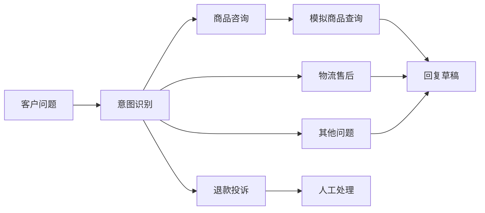

# 电商客服辅助原型｜Coze 工作流与知识库实践

围绕商品咨询、物流售后、退款投诉和规则问答，实践需求拆解、工作流分支、结构化输出与人工接管。使用 Coze 和 AI 辅助开发；当前是两个独立模块，商品资料为模拟数据，未接入真实抖店消息、订单或退款操作。

本目录是**精选源码摘录与案例证据**，不是完整平台项目导出。可以本地检查商品查询工具；完整分流图仍依赖未导出的节点、配置及 Coze 运行环境。

## 业务问题与方案

客服需要先判断问题属于哪类，再决定查什么资料、追问什么、是否交给人工。回答看起来流畅并不足以证明业务事实正确：商品参数需要查询依据，售后条件需要规则来源，退款投诉需要人工审核。

| 模块 | 输入 | 输出 | 实现与证据 |
| --- | --- | --- | --- |
| 客户咨询分流 | `user_message` | `intent`、`reply`、`need_human` | LangGraph 四路分支；导出的图与状态结构；模拟商品工具；一条历史平台运行记录 |
| 售后规则问答 | `question` | `answer`、`source`、`need_human` | 可见检索与回答节点；开发记录中的来源缺失修复过程；完整源码及独立云端复测待补 |



售后规则问答另行执行 `question → 规则检索 → 依据片段回答`。图中没有把它画成已经接入分流的子流程，因为本次没有确认两个项目互相调用。

## 可以直接检查的文件

- [分流图](triage/src/graphs/graph.py)：四类意图对应的节点、条件边和结束节点。
- [输入输出与状态](triage/src/graphs/state.py)：用 Pydantic 定义数据契约。
- [模拟商品工具](triage/src/tools/product_lookup_tool.py)：只有 TEST001、TEST002；未知编号返回 `not_found`，不补造商品资料。
- [平台运行样例](evidence/triage-run.json)：2026-10-06 的输入、输出与总耗时，2026-10-12 从运行记录面板核对后整理。
- [证据与验收范围](evidence/VALIDATION.md)：源码、历史运行、开发摘要与当前检查分别说明。
- [来源缺失排障案例](docs/SOURCE-DEBUGGING.md)：从分段、检索上下文到来源字段检查问题。
- [简历与面试讲解](docs/INTERVIEW.md)：按实际参与采用。
- [导出来源说明](SOURCE-NOTES.md)：哪些文件已保存，哪些尚未导出。

## 本地检查

需要 Python 3.11+，只使用标准库，不配置 Token，不调用模型或真实平台。

```bash
cd projects/coze-ecommerce-support
python verify_product_lookup.py
```

检查两条已知商品、编号大小写与空白、未知编号、空编号。未知资料必须返回未找到，并且不能携带虚构商品信息。输出是**原模拟工具的本地结果**，不能当作模型分流、RAG 或真实店铺查询测试。

不要直接运行 `graph.py`：此处没有导出五个回复/分类节点、五份模型配置、平台入口、SDK 运行上下文和知识库绑定。将来完整迁移时，应从现有项目补导出，而不是用新编代码冒充原实现。

## 当前验收边界

历史运行样例证明当时一次 TEST001 商品咨询返回了模拟资料，不能推导所有问题都通过。退款投诉转人工是明确需求；本次没有独立复测完整路径。规则外问题需要转人工，但知识库修复的三个测试只见开发摘要，未核对其原始运行记录。

尚未完成：真实消息接入、订单/物流只读查询、两模块串联、实际人工工单接管、稳定性与成本评估。`need_human=true` 是标记，不代表客服人员已经收到任务。示例政策也不能当作真实平台承诺。

整理日期：2026-10-12。没有声称生产交付、付费客户、自动退款或无依据的效率提升。
