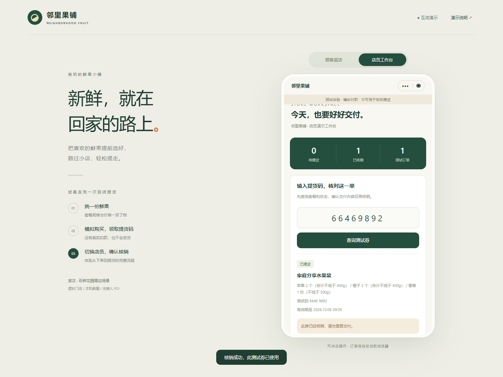

# 邻里果铺：团购业务闭环演示

虚构水果门店的本机演示：选套餐 → 模拟购买 → 测试提货码 → 店员核销。用于讲解业务规则和需求验收；**实际扣款为 0 元，不可真实收款或提货**。


## 三分钟启动

Node.js 22+，在本项目目录运行：

```bash
npm test
npm start
```

访问 `http://127.0.0.1:8766`。无需 npm 安装依赖；服务只监听本机。关闭终端即停止。

## 演示脚本

1. 选择一个套餐，勾选测试规则，确认模拟购买。
2. 展示 8 位测试提货码；切换“店员核销”，查询测试券并再次确认核销。
3. 重查同一券，展示重复核销被拒绝。
4. 用另一张未使用券演示模拟退款，检查券作废与库存恢复。
5. 刷新页面，查看本地订单仍保留；需要重放时通过演示说明重置测试数据。



## 可讲解的业务判断

- 金额以整数分保存，历史订单保存套餐快照；改商品不会改变旧订单价格。
- 下单扣减库存，退款恢复库存；已用券不可重复交付。
- 原生小程序与网页共用 `miniprogram/utils/core.js`，但各自使用本地存储，数据不互通。
- `?flow=poi` 提供视频 → 门店位置 → 假设服务关联 → 模拟购买的概念流程，用于理解需求，不代表微信真实入口或权限。

## 微信原生源码与限制

可用微信开发者工具导入本目录；`project.config.json` 使用 `touristappid` 占位。本次未进行开发者工具编译或微信真机验收。

客户端数据可以修改；没有真实身份与门店权限隔离、多设备共享、并发事务、可信服务端、支付通知和生产安全券码。要正式交易须另做后端与平台接入。这里的截图来自原项目虚构测试，不是真实订单证据。
