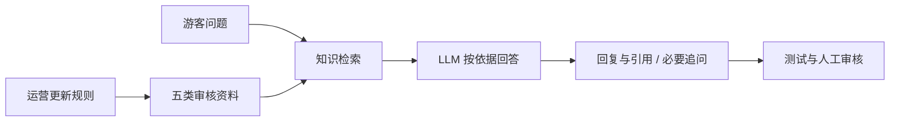

# 青溪景区 RAG 客服

为虚构景区处理票务、开放时间、交通、退改和游客服务问题。将可更新资料与生成规则分开，回答提供出处；资料不足时追问或说明限制，不编造订单、库存、天气或退款结果。

## 架构与文件

- `knowledge/`：五类虚构资料，条款编号与正文在一起。
- `qingxi-chatflow.yml`：JSON 格式的 Dify DSL，JSON 属于 YAML 兼容子集；四节点 Chatflow。
- `prompts/system.txt`：原项目系统指令，保持原样。
- `test-cases.json`：20 道题与期望。原文件的 actual/result 属于较早阶段，历史最终结果以 evidence 中 2026-09-12 记录为准。
- `update-demo/`：票务 v2，从成人票 80 元更新为 90 元。
- `evidence/cloud-validation-2026-09-12.md`：历史 20/20 云端测试与一次版本引用错误的修正记录。

## 复现方式

1. 使用有模型与嵌入模型权限的 Dify 工作空间，创建知识库，上传五份 `knowledge/*.txt`。示例配置使用 `text-embedding-v3`，原生成模型为 `qwen-flash`；换模型后重新评估，不能沿用旧结果。
2. 导入 `qingxi-chatflow.yml`。公开快照已清空 `dataset_ids`，在知识检索节点选择自己的知识库，再在 LLM 节点选择自己的可调用模型。API Key 只放平台配置中。
3. 初始分段约 500 tokens、重叠 50，Top K=4，未启用重排序。检索先用明确关键词检查条款；这些是原项目起点，不代表通用最优参数。
4. 打开引用来源，预览成人票、儿童票边界、退票条件和无实时数据问题。按 test-cases 记录实际答复、来源、是否通过。
5. 测知识更新时，禁用 v1 票务文件，启用并索引 `update-demo/QX-TICKET-v2.txt`，新会话确认成人票 90 元和来源 v2。K19/K20 使用 v2，其他历史题按 v1 验收。

## 验证与限制

2026-09-12 的项目记录显示 20 道云端预览题全部符合预期。本次打包没有重新调用付费／限额云端模型；记录不代表目前所有入口仍可用。最终来源规则曾在草稿预览通过，公开应用新版本发布和公开页复测仍待确认。

错误案例：更新金额后，正文照抄指令示例的旧文档版本号。后续改为正文列条款名称与编号，由平台引用卡片显示文件来源。排障体现“答案正确”和“引用正确”需分别核查。

这是小样本固定题验收，不是生产准确率；没有订单、支付、客流等实时接口，没有私有化部署证据。五类资料、线路、电话与价格均为虚构。

原平台参考来源见 [SOURCE-NOTES.md](SOURCE-NOTES.md)。本仓库未包含 Dify 平台源码。
