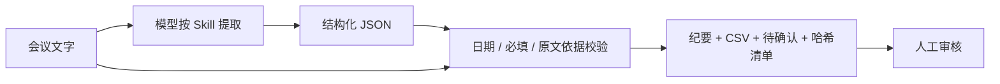

# 会议纪要与任务交付 Skill

把中文会议文字整理为 `minutes.md`、`tasks.csv`、`pending.md`，并保留结构化结果和运行清单。业务重点是区分决策、提议与未决问题，缺负责人和日期时保留“待确认”，每项任务附可核对的连续原句。

## 为什么用 Skill + 脚本

模型负责语义提取；[SKILL.md](SKILL.md) 描述业务规则，[输出契约](references/output-contract.md) 和 [模板](templates/minutes.md) 固定交付格式，脚本负责结构、日期、原文摘录和文件输出。脚本检查不等于模型语义理解正确。



## 无模型的文件导出演示

安装 Node.js 22+，在仓库根目录运行：

```bash
node skills/meeting-delivery/scripts/export-meeting.mjs skills/meeting-delivery/examples/codex-extraction.json skills/meeting-delivery/samples/02-缺少分工与期限.txt skills/meeting-delivery/sample-runs
node --test skills/meeting-delivery/tests/*.test.mjs
```

样例应输出两项任务，未指定的信息为“待确认”，老人全部免票保留为提议。每次运行创建新目录，不覆盖旧结果。CSV 使用 UTF-8 BOM，可用 Excel 打开。

这里重放的是已有 JSON，**没有调用模型**。`reference/` 是人工参考答案，不能作为新会议记录输入。

## 安装到支持 Skills 的 Agent

把 `meeting-delivery/` 文件夹复制到所用 Agent 支持的技能目录，保留 `SKILL.md`、`scripts/`、`references/`、`templates/`。在 Agent 内指定会议日期、标题、原文路径和输出目录；文件路径以本机实际位置为准。首次运行后核对原文与三份结果。

## 行为与限制

- evidence 必须能在原文找到；不存在的摘录会拒绝导出。
- CSV 的 `=`、`+`、`-`、`@` 等公式起始字符作文本处理。
- 创建唯一目录，附原文、JSON 与输出文件 SHA-256，便于核查来源与变化。
- 日期须为真实 `YYYY-MM-DD` 或任务期限“待确认”；缺字段必须说明待确认事项。
- 仅支持文字，不转录音频，不发送邮件，不创建在线任务，不自动确认业务决策。

历史记录：2026-09-11 导出与结构相关的本地检查通过；Codex 处理过一份模糊分工样例。WorkBuddy 已安装扫描技能，但 6 个模型语义场景仍未验证。`test-cases.json` 保留这一状态，不改写成通过。

本次公开快照的复核见仓库 [VALIDATION.md](../../docs/VALIDATION.md)。Skill frontmatter 已整理为兼容结构，操作指令移除本机环境断言；业务边界与导出实现保持不变。
